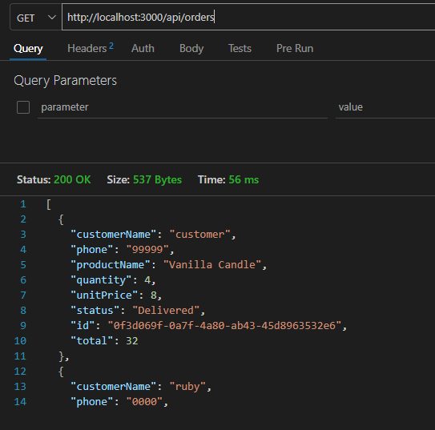
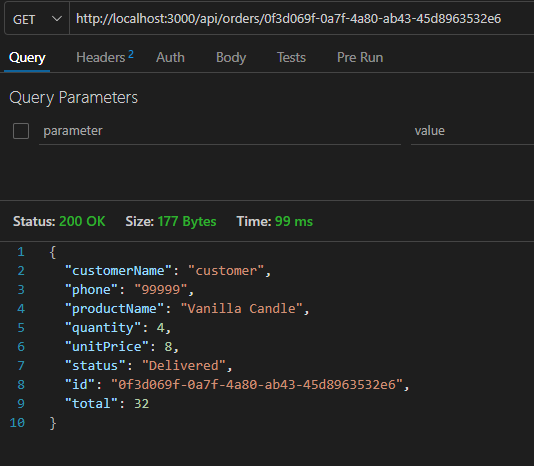
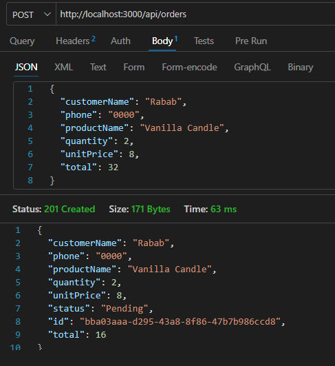
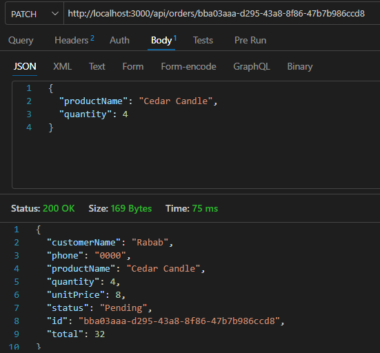
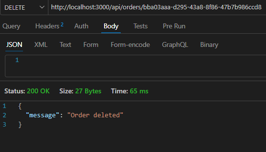
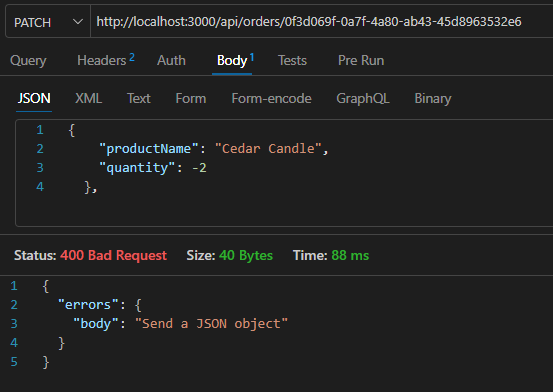
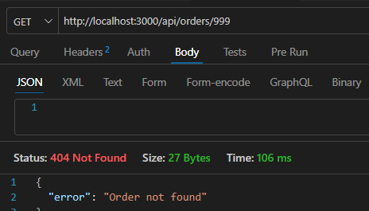

# REVIEW

Screenshots are in `docs/SS`.

## Test results

**GET list: `GET /api/orders` returned [200] and all orders.**

**GET by id : `GET /api/orders/id` returned [200] and the order.**

**POST create: `POST /api/orders` returned [201] and the created order.**

**Note:** we put total 32 , but the total is wrong, then the server ignore this total and put the correct one.

**PATCH update: `PATCH /api/orders/id` returned [200] and the updated order.**

**DELETE: `DELETE /api/orders/id` .**

**Invalid input: we use PATCH and update the quantity as negative number, it gives [400] with error message.**

**Unknown ID: we use GET to access an order with a non existing id, it gives [404] .**

## 1. Trace one Add Order action
the customer add the order in the order form, and the form sends POST request to the route handler in "app/api/orders/route.ts".Then the server makes the order "pending", calculates total, gives it an id and stores it.Finally, the form updates the list and the counts.

## 2. Where is the total calculated, and why is that important?
The total is calculated on the server in "lib/orders.tsx" file. It takes the price and the quantity with rounding the result to max 2 decimal places.Route handler calls the fct, so the rule is in 1 place and it is used for POST & PATCH (creating, updating, editing). The server ignores any total, the prices is editable for the owner so it can make discounts later. 

## 3. One invalid request
I used PATCH to update the status of an order, and I put "Flying"(the status must be pending, delivered or preparing).Then the server gave 400 status error with a message telling that the statement must be pending, preparing or delivered.

## 4. PATCH vs replacing an entire object
PATCH updates only the specific fields I send in order, and the other fields stay the same.For ex: when I update only the quantity, the customer name doesn't change.Whereas, replacing an entire object (PUT) is a replacing of whole order with new data, so I must send all the fields.In this proj, database is out of scope so updates happens on stored order.

## 5. What happens to orders after a server restart?
My orders are stored in memory, in a global array (`globalThis.orderStore`)
in `lib/orders.ts`. They are not saved in a file or a database, so they are
lost when the server really stops.
At first my orders stayed after I "restarted", because `npm run dev` kept
saying "You can access the existing server", which means the old server
process was still running on port 3000 and holding the data in memory. I
found its PID with `netstat`, stopped it with `taskkill`, and started
`npm run dev` again. This time the list was empty. This confirms that the
data exists only while the server process is running.

## 6. AI suggestion I corrected or verified
The AI suggested that I restart the server by stopping it and running
`npm run dev` again, and that my orders in memory would disappear. When I
tested it, the orders stayed. I did not accept the suggestion without
checking. I used `netstat -ano | findstr :3000` and found that the old
server (PID 12108) was still running, and `npm run dev` said "You can
access the existing server". After I stopped it with `taskkill` and
started again, the list was empty. My evidence was the `netstat` output
and the empty list after the restart.