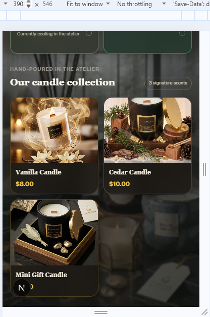

# Testing

Tested with Thunder Client against http://localhost:3000.
Write the **actual** result of each test. Do not copy the expected result
unless it is what really happened.
Screenshots are in `docs/evidence/`.

## API tests
| Test | What I sent | Expected | Actual result |
|---|---|---|---|
| List orders | `GET /api/orders` | 200, array | as expected |
| Read existing order | `GET /api/orders/[id]` | 200, object |  as expected  |
| Create valid order | 3 x $8 | 201, ID, total 24, Pending |  as expected  |
| Omit customer name | POST without name | 400 |  as expected  |
| Blank phone | POST with `""` | 400 |  as expected  |
| Quantity 0, -1, 1.5 | POST/PATCH | 400 |  as expected |
| Negative or non-numeric unit price | POST | 400 |  as expected |
| Status `Flying` | PATCH | 400 |  as expected  |
| Malformed JSON | POST/PATCH | 400, not 500 |  as expected  |
| Empty PATCH body | PATCH `{}` / no body | 400 | [first 500, then fixed: actual] |
| Update quantity only | PATCH `{ "quantity": 4 }` | 200, name unchanged, total 32 |  as expected |
| Wrong `total` sent | POST with `total: 0` | server returns correct total |  as expected |
| Change an ID | PATCH with a different `id` | ID unchanged |  as expected  |
| Delete existing order | `DELETE /api/orders/[id]` | 204, no body |  as expected  |
| Read/update/delete unknown ID | any | 404 |  as expected  |

## Maya's acceptance scenario (dashboard)

Starting state: 1 order in the list, after a clean server restart.

1. **Add an order for 3 Vanilla Candles at $8 each.**
   The server returned a total of $24.00 and the status `Pending`.
   Counts after: Total [24], Pending [2], Delivered [0].

2. **Change the quantity to 4.**
   The server recalculated the total and returned $32.00.

3. **Change the status to Delivered.**
   The Delivered count increased by 1 and the Pending count decreased
   by 1. Counts after: Pending [1], Delivered [1].

4. **Set the quantity to -2 through Thunder Client.**
   `PATCH /api/orders/[id]` with `{ "quantity": -2 }` returned `400`
   with the message "[Send a JSON Object]". I fetched the order again and it
   still had quantity 4 and total $32.00.

5. **Send `total: 0` with otherwise valid data.**
   `POST /api/orders` with `total: 0` returned `201` with the correct
   total [32]. The server ignored the client's total and
   calculated it itself.

6. **Create a second, accidental order and delete it.**
   I added the order (Total count became [3]), then deleted it from the
   dashboard. The order disappeared from the list and the counts went
   back to Total [2], Pending [1], Delivered [1].

7. **Fetch the deleted order by ID.**
   `GET /api/orders/[deleted id]` returned `404` with the message
   "[Order deleted]".

## Scripts
- `npm run lint`: 0 errors, 6 warnings. All are unused-variable warnings
  (`getOrder` in `route.ts`, and `loadError`, `formError`, `saving`,
  `pendingId` and `retry` in `OrdersDashboard.tsx`). They do not break the
  app.
- `npm run build`: completed with no errors. All 6 static pages were
  generated, and `/api/orders` and `/api/orders/[id]` are dynamic routes.

## Mobile check
I checked the dashboard in the browser's mobile view (width [390 px]).

Screenshot:

 

- The layout [fits the screen].
- The navigation, the order form and the orders table [are readable and
  usable ].
- [I added an order from the mobile view and it worked].

## Things I could not verify
None.